# JANITOR THE-ROTATOR

## Índice

- [1. Descripción general](#section-1-descripcion-general)
  - [1.1) Concepto.](#section-1-1-concepto)
  - [1.2) Género.](#section-1-2-genero)
  - [1.3) Setting.](#section-1-3-setting)
  - [1.4) Características principales.](#section-1-4-caracteristicas-principales)
- [2. Gameplay](#section-2-gameplay)
  - [2.1) Objetivo del juego.](#section-2-1-objetivo-del-juego)
  - [2.2) Core loops.](#section-2-2-core-loops)
- [3. Personaje jugador](#section-3-personaje-jugador)
  - [3.1) Estadísticas.](#section-3-1-estadisticas)
  - [3.2) Controles.](#section-3-2-controles)
- [4. Mecánicas](#section-4-mecanicas)
  - [4.1) Selección inicial de bestias para combatir.](#section-4-1-seleccion-inicial-de-bestias-para-combatir)
  - [4.2) Estadísticas y daño realizado.](#section-4-2-estadisticas-y-dano-realizado)
  - [4.3) Equipamiento de las bestias mágicas.](#section-4-3-equipamiento-de-las-bestias-magicas)
  - [4.4) Tipos de bestias y multiplicadores de daño.](#section-4-4-tipos-de-bestias-y-multiplicadores-de-dano)
  - [4.5) Combate automático y formas de atacar.](#section-4-5-combate-automatico-y-formas-de-atacar)
  - [4.6) Rotación de las bestias en combate.](#section-4-6-rotacion-de-las-bestias-en-combate)
  - [4.7) Mecánicas especiales de bestias.](#section-4-7-mecanicas-especiales-de-bestias)
  - [4.8) Mecánicas de líderes de equipo enemigos.](#section-4-8-mecanicas-de-lideres-de-equipo-enemigos)
  - [4.9) Sistema de experiencia (Aura).](#section-4-9-sistema-de-experiencia-aura)
  - [4.10) Recurso almas de mago, mejora de bestias y equipamiento.](#section-4-10-recurso-almas-de-mago-mejora-de-bestias-y-equipamiento)
  - [4.11) Recurso de vidas y respawn](#section-4-11-recurso-de-vidas-y-respawn)
  - [4.12) Avance por el mapa y su generación.](#section-4-12-avance-por-el-mapa-y-su-generacion)
- [5. Mundo del juego y contenido](#section-5-mundo-del-juego-y-contenido)
  - [5.1) Personajes.](#section-5-1-personajes)
  - [5.2) Bestias mágicas y equipamientos.](#section-5-2-bestias-magicas-y-equipamientos)
  - [5.3) Obstáculos.](#section-5-3-obstaculos)
  - [5.4) Entornos y contenido respecto a enemigos](#section-5-4-entornos-y-contenido-respecto-a-enemigos)
- [6. Interfaz](#section-6-interfaz)
  - [6.1) Cámara](#section-6-1-camara)
  - [6.2) HUD](#section-6-2-hud)
  - [6.3) Menús](#section-6-3-menus)
- [7. Experiencia del juego](#section-7-experiencia-del-juego)
  - [7.1) Objetivos de la experiencia](#section-7-1-objetivos-de-la-experiencia)
  - [7.2) Resultados esperados](#section-7-2-resultados-esperados)
- [8. Dinámicas](#section-8-dinamicas)
- [9. Estética y contenido](#section-9-estetica-y-contenido)
  - [9.1) Mundo](#section-9-1-mundo)
  - [9.2) Estilo artístico](#section-9-2-estilo-artistico)
  - [9.3) Diálogos](#section-9-3-dialogos)
- [10. Referencias.](#section-10-referencias)

<!-- END_TOC -->

**Equipo de desarrollo:**

Ángel Seijas de Ema

Miguel Gómez García

Camilo Sandoval Sánchez

Sergio Higuera Gil

13/10/2026

## 1. Descripción general

### 1.1) Concepto.

Juego 2D con vista top-down centrado en un sistema de combate automático excéntrico junto a deckbuilding.

El jugador va acumulando bestias mágicas que usa para luchar contra una serie de atacantes que asaltan la escuela de magia en la que trabaja.

### 1.2) Género.

- Autobattler.

- Combate con cartas.

- Fantasía

- *Público objetivo:*

Buscamos apelar a un público que quiera una experiencia estratégica simple y breve pero interesante, sin tener una complejidad demasiado elevada de mecánicas pero con suficientes interacciones llamativas.

### 1.3) Setting.

Eres un conserje en una escuela de magia. Un día cualquiera un grupo desconocido ataca la escuela, matando y robando a todo el que encuentran.

 A nuestro protagonista le roban -**un anillo de compromiso**- . Durante el asalto, en un momento de tranquilidad, se encuentra a un monstruo mágico y consigue domarlo gracias a una propiedad mágica que poseía y desconocía, su aura.

 A partir de ahí empieza una serie de combates, motivados inicialmente por el deseo del personaje principal de vengarse y recuperar el anillo.

 Va luchando contra los atacantes de la escuela, y poco a poco va descubriendo más cosas sobre el grupo de enemigos.

### 1.4) Características principales.

#### A) Selección de criaturas

Antes de empezar un combate escoges previamente una serie de 5 bestias mágicas con las que luchar, teniendo conocimiento completo del enemigo al que te vas a enfrentar (ya que se podrá ver).

Estas se disponen en una formación pentagonal. Véase más en [Selección inicial de bestias para combatir.](#gdd-j5dd6sxpw5o)

#### B) Combate

Una vez se hace esa selección, el combate empieza y todos los ataques son automáticos. El único control que tiene el jugador sobre la batalla es girar las 5 bestias elegidas en el pentágono.

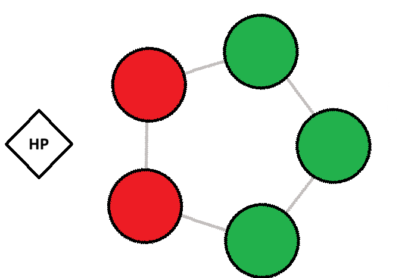

Las bestias del frente (verdes) serán las que normalmente puedan atacar, mientras que las de atrás serán incapaces (con excepciones).

Una vez derrotada una bestia, el sitio en el que estaba colocada queda vacío, y más ataques a este mismo sitio suponen daño al “líder” del equipo; la condición de victoria de los combates será derrotar al líder enemigo sin que el tuyo muera.

#### C) Selección de rutas de combate

La progresión del juego se hace mediante un mapa en el que el jugador puede escoger (si los hay) diferentes caminos que se ramifican.

Estos caminos llevan a diferentes nodos conectados entre sí, que significan diferentes cosas; primordialmente encuentros contra enemigos de diferentes dificultades y recompensas de diferentes formatos.

#### D) Subida de niveles y Deck-Building

El jugador podrá optar por ir por caminos con más encuentros para obtener más “experiencia”, denominada aura en este juego. Esta servirá para poder recibir bestias más poderosas en las diferentes casillas de recompensas; a partir de ciertos niveles se desbloquea una pool mayor y mejor de bestias que podrás encontrar.

También se proporcionarán bestias y equipamientos extra al ir subiendo de nivel.

Una vez se alcanza una casilla de recompensa (o alguna otra recompensa por niveles) se le dará a elegir, según la casilla, entre 3 bestias/equipamientos, de los cuales elige 2.

## 2. Gameplay

### 2.1) Objetivo del juego.

El objetivo del juego se aclara según se va jugando; se ha de superar una serie de combates crecientes en dificultad, escogiendo el camino que se crea más conveniente mientras se van desbloqueando más bestias mágicas con las que luchar.

Para ello estas elecciones de bestias han de ser estratégicas, y tener en cuenta dónde las colocas en tu pentágono, teniendo en cuenta las posibles rotaciones que el enemigo o tú mismo puedes hacer durante los combates.

### 2.2) Core loops.

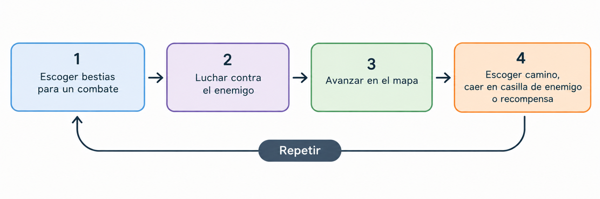

## 3. Personaje jugador

### 3.1) Estadísticas.

El jugador representa en combate el papel de [“líder de equipo”](#gdd-uvhrortc1at8), teniendo 100 HP.

Esta figura no interactúa en combate de ninguna otra forma (aunque sí será el jugador con sus acciones las que giren el pentágono de bestias).

También tendrá [3 vidas](#gdd-bo2bq4643tcw), [nivel 0 de aura](#gdd-q4ym4w5ph4za) y **se le dará a elegir inicialmente al jugador 3** [bestias básicas](#gdd-yb24mt16r6ei) (las denominadas “soldado raso”) de cualquiera de los 5 [elementos ](#gdd-ftclo2day3hi)con interacciones de fortaleza y debilidad.

Con esas 3 elecciones, podrá elegir con total libertad entre esas 5 bestias, pudiendo repetir si se desea.

### 3.2) Controles.

El botón de “Esc” habilitará el menú de pausa

El juego se controlará en su mayoría a través del pulsar los elementos del juego con el ratón.

## 4. Mecánicas

### 4.1) Selección inicial de bestias para combatir.

Lo primero que se hace al iniciarse un combate es abrirse el siguiente menú:

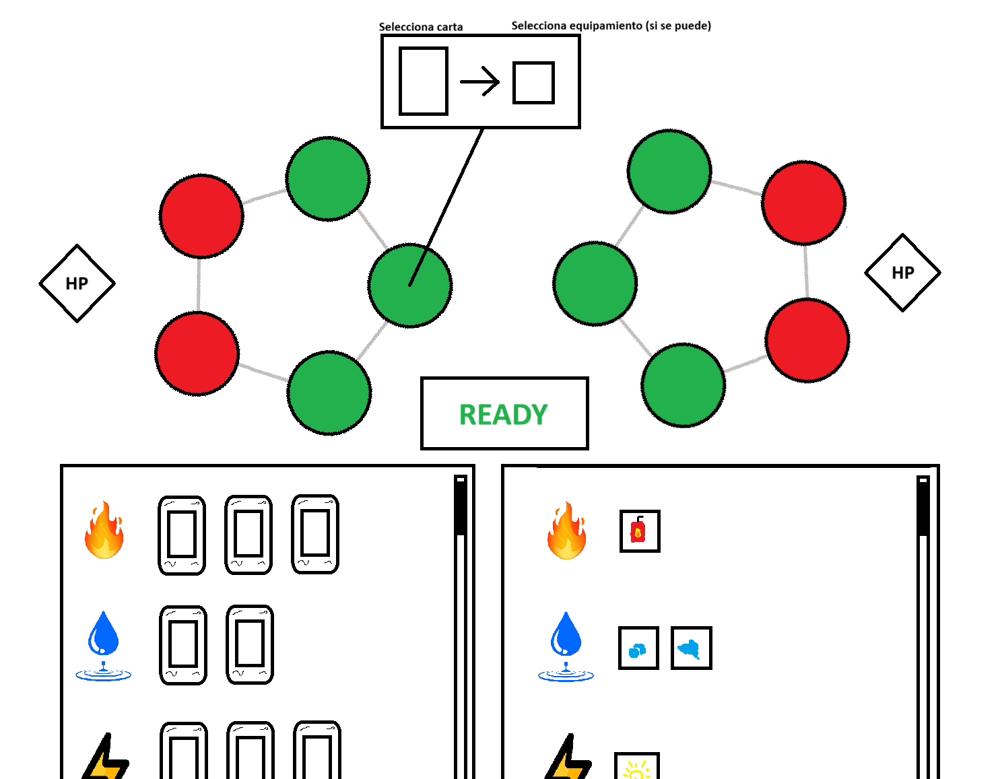

En este se observan **2 ventanas**, una de **bestias mágicas,** separadas por tipos, en la que puedes observar todas las bestias que has adquirido hasta ahora, con sus stats y dibujo en forma de carta.

Se podrá scrollear por esa ventana para observar la totalidad de tus cartas.

La otra ventana es de **equipamientos,** con el mismo comportamiento.

**Colocando el mouse** o **manteniendo el click** sobre cartas de bestias mágicas o equipamientos se abrirá una pequeña ventana adyacente con texto que dé más información sobre sus comportamientos.

Por ejemplo, para el caso de los equipamientos, explican las stats que modifican. Para el caso de bestias indicarían si aceptan o no un equipamiento, si tienen alguna forma de atacar especial… Cualquier información extra necesaria para entender su funcionamiento.

El jugador podrá ver **los enemigos contra los que se enfrenta** colocados ya en el lado opuesto del campo de batalla (que podrá ser otra disposición pentagonal o un gran enemigo unitario).

Con esta información, el jugador clicar las **posiciones en su pentágono** y se abrirá una ventana más en la que se puede arrastrar (o clickar para seleccionar donde vá a colocar, y luego clickar un objeto adecuado para colocarlo) primero la carta de bestia mágica y luego una equipación para esta, si lo admite (algunas bestias mágicas en concreto no permitirán equipamiento).

Una vez finalizada la selección se podrá clicar un botón de “READY” para iniciar la batalla. **Tus bestias siempre empezarán con la máxima vida.**

### 4.2) Estadísticas y daño realizado.

Las bestias mágicas tendrán 4 estadísticas:

Vida (HP), Ataque, Defensa y Velocidad.

La vida es simple, representando cuantos puntos de daño le queda a un personaje para morir en combate (si mueren no se pierden permanentemente, para el siguiente se recuperan), al llegar a 0 HP.

El ataque representa el daño base que realiza en cada ataque una bestia mágica. A este se le pueden aplicar los multiplicadores de daño de los tipos elementales, y podrá ser reducido por la defensa.

La defensa se representa **por resta,** reduciendo el daño que se recibe en esa cantidad. Actualmente el daño realizado en un ataque se calcula: DañoTotal = Daño \* MultiplicadorElemental - Defensa; siendo 0 el mínimo posible de daño.

La velocidad indica qué tan rápido ataca una cierta bestia mágica, dándose el combate automático en tiempo real. Se representará en pantalla mediante una barra de progresión que va representando el build-up del ataque.

### 4.3) Equipamiento de las bestias mágicas.

Dentro de la descripción de cada bestia mágica se dirá si esta puede aceptar o no equipamiento.

Esto es ya que por diseño, algunas bestias mágicas serán más fuertes por defecto y no necesitarán buffs de equipamiento.

Las bestias mágicas que si aceptan equipamiento **solo podrán usar equipamientos de su mismo tipo**, es decir, bestias de tipo agua usan equipamientos de tipo agua.

Una vez equipado se podrá quitar únicamente durante la selección previa al combate, y una vez iniciado no se podrá cambiar hasta el siguiente combate.

Cada equipamiento tendrá un cierto efecto, como aumentar los HP de la bestia, el daño por ataque… O trade-offs, bajando la vida pero aumentando la defensa, por ejemplo.

### 4.4) Tipos de bestias y multiplicadores de daño.

Las bestias pertenecen todas a un tipo de elemento de los siguientes, teniendo cada uno una debilidad y una fortaleza contra los elementos adyacentes del diagrama:

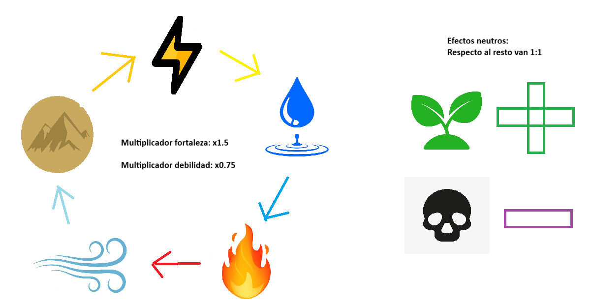

Cuando 2 bestias de elementos no relacionados, como **fuego** y **tierra** luchan, se realizan daño en una proporción 1:1, con normalidad.

Si una bestia ataca a un elemento contra el que es débil (por ejemplo, **fuego** ataca a **agua**), el daño que realiza se ve multiplicado por **x0.75,** redondeando los decimales de forma habitual.

A su vez, si una bestia ataca a un elemento contra el que es fuerte (**agua** ataca **fuego**) el daño que realiza se ve aumentado por **x1.5**. Los decimales igualmente se redondean de forma habitual.

### 4.5) Combate automático y formas de atacar.

Las bestias mágicas atacarán de forma completamente automática y en tiempo real, mediante su estadística de “tiempo de ataque”.

Cuando puedan atacar, se verá encima suya una pequeña barra de “progreso” del ataque, o como lo vamos a llamar desde ahora, build-up del ataque. Esta barra representa el porcentaje de tiempo desde que se inicia el ataque hasta que se realiza (sería tiempoPasado/tiempoTotal).

Al llenarse esta barra el daño se realiza contra el enemigo al que se está apuntando de forma instantánea.

Por otra parte, está cómo deciden las bestias mágicas a que enemigo atacar; **si no se define de otra forma**, las bestias mágicas en la parte frontal (en nuestros esquemas, los slots verdes) atacan directamente enfrente suya:

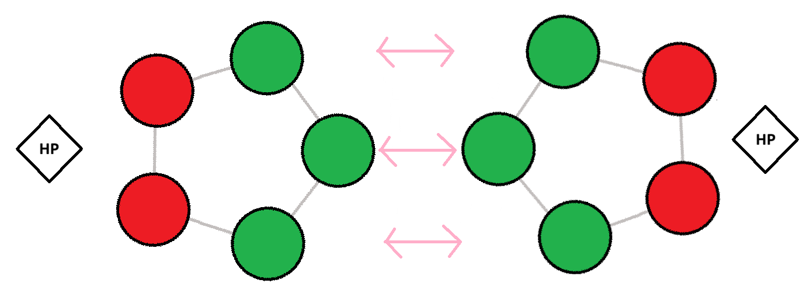

Por otra parte, algunas bestias mágicas tendrán sus propias formas de atacar; por ejemplo una que pueda atacar desde atrás a las criaturas de enfrente. Esto se definirá en la descripción de la carta de la bestia mágica con absoluto detalle.

**Cuando se ataca un slot que no tiene bestia mágica** (por ejemplo porque ya ha sido derrotada) el daño se realizará al líder del equipo atacado, siendo la condición de victoría derrotarlo, al llevar su vida a 0.

Además algunas bestias tendrán la propiedad de atacar directamente a los enemigos, ignorando el combate entre bestias.

### 4.6) Rotación de las bestias en combate.

En combate el jugador dispondrá de 2 botones debajo de su formación con los que rotarla:

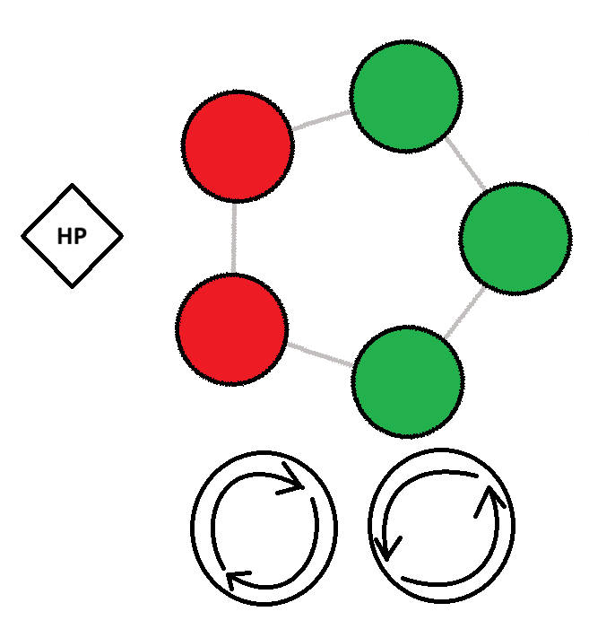

Al clicar uno de los botones se realiza una pequeña animación de rotado, y durante esta los botones se engrisecen, siendo imposible clicarlos repetidamente en rápida sucesión.

La duración de este **cooldown** se enseñará encima de los botones con un contador, y esta duración podrá ser modificada dependiendo de las bestias mágicas que se jueguen. **Por defecto será de 5 segundos.**

Al rotar, si una bestia mágica estaba en cooldown de ataque, y pasa a no poder atacar, su build-up de ataque se reinicia a 0. **Si antes podía atacar, y después de la rotación todavía puede atacar, su build-up no se reinicia.**

### 4.7) Mecánicas especiales de bestias.

En esta sección se definirán todas las mecánicas distintivas de diferentes bestias, como podría ser su forma de atacar, efectos que realizan al hacerlo…

#### Ataque triple.

Si la bestia se sitúa en la posición delantera del medio (2), cuando ataque lo hará a las tres bestias enemigas del frente a la vez (1, 2 y 3).

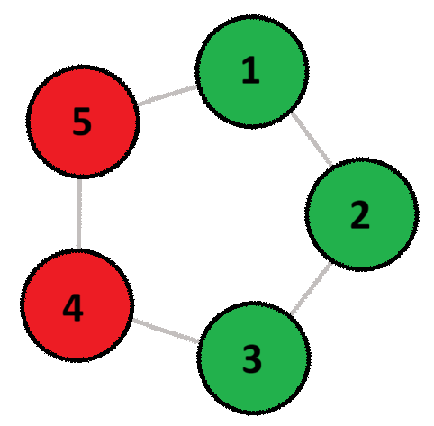

Usada por: [Cerbero](#gdd-b6sfk4n8b3iz)

#### Ataque penetrante.

Al atacar a cualquier bestia delantera (1, 2 y 3), realiza el mismo daño a ambas posiciones traseras (4 y 5).

Usada por: [Elefante Eléctrico](#gdd-3wbofye34upj), [Maestro de las baratijas](#gdd-3scrv77zl5bf).

#### Ataque global.

Al atacar, la bestia realiza su ataque a todas las posiciones del pentágono enemigo.

Usada por: [Hada](#gdd-weilu0in7gfx), [Seth Dios de las Tormentas](#gdd-i40n0vyzxvwd), [Hades Dios del inframundo](#gdd-e65u69s4vh0g)

#### Ataque descontrolado

En las posiciones traseras (4 y 5) realizará ataques a todas las bestias aliadas, y opcionalmente a sí misma.

Este ataque se realizará dañando a los aliados, pero con un funcionamiento distinto al de la mecánica de “[daño a los aliados](#gdd-tfiq8s4vwc79)”; se interpretará como un ataque normal  y activará mecánicas como la de “[reflejo del daño](#gdd-v90qzcnh7to)”.

Usado por: [Bloodbath](#gdd-47quy17xmiaj)

#### Incapacidad de hacer daño a domadores.

La bestia podrá hacer daño a otras bestias pero sus ataques no tendrán efecto en la vida del rival.

Usada por: [Cerbero](#gdd-b6sfk4n8b3iz), [Medusa](#gdd-o5s7sejxjbgy)

#### Incapacidad de atacar.

La bestia no podrá efectuar ataques para hacer daño al rival.

Usada por: [Esponja de Mar](#gdd-2t4gsvjltkuj), [Gárgola de piedra](#gdd-n4p5mrb6g173), [Protector de la Tierra Atlas](#gdd-kx89sliwi55g), [Bestia enredadera](#gdd-cp8ovvqhyd68), [Árbol Sabio](#gdd-d7dt87rd5xne), [Gaia Madre Tierra](#gdd-mmgkrejknslu), [Ninfa espíritu del bosque](#gdd-djweikp5mqsx)

#### Cambio de las estadísticas.

Las bestias pueden tener un aumento o reducción de sus estadísticas en el combate, pudiendo aumentarlas o disminuirlas en el transcurso del combate ante un evento. Una vez finalizada la batalla las estadísticas siempre regresarán a su valor base.

Este cambio también podrá ser realizado por una bestia afectando a otras, según los criterios que se vean adecuados (por ejemplo; debuffs a bestias enemigas que sean de un tipo diferente, o buffs a aliados pero solo si son del mismo tipo…). Al morir una bestia que bufa a otra, el buff desaparece.

Usada por: [Horror ](#gdd-7ix3vhp7und2)[Abisal](#gdd-7ix3vhp7und2), [Sirena](#gdd-lae226ksr096), [El Horno](#gdd-m27ldpkq0r1c), [León de Fuego](#gdd-xkbj58q8307v), [Apolo Dios del Sol](#gdd-6tedbxfeca2g), [Djinn](#gdd-gair9rzp9uh), [Arcangel portador de la espada](#gdd-kslls03xj7iy), [Torbellino](#gdd-dvxr5hr90wi5), [Hecatonquiros](#gdd-g5lklrvl0can), [Acelerador de partículas](#gdd-ax8fh6jy7nzx), [Seth Dios de las tormentas](#gdd-i40n0vyzxvwd), [Maestro de las baratijas](#gdd-3scrv77zl5bf), [Relojero Maestro](#gdd-lznq377gzo35), [Bloodbath](#gdd-47quy17xmiaj)

#### Ralentización de ataques.

Esencialmente es un cambio de estadísticas para el tiempo, pero no es “permanente”; aumenta o disminuye el cooldown actual del build-up del ataque, pero una vez realizado (o reiniciado por otro motivo) el valor al que vuelve es el cooldown original de la bestia.

La forma de aplicar este cambio podrá ser mediante cualquier evento.

Usada por: [Chispas](#gdd-45jzyrwa5djo).

#### Bloqueo de las estadísticas.

Algunas bestias tendrán bloqueadas sus estadísticas o bloquearán las de otras bestias, siendo imposible que cambien (sobreescribiendo a **cualquier otra mecánica** que modifique estadísticas).

Usada por: [Esponja de mar](#gdd-2t4gsvjltkuj), [Gárgola de piedra](#gdd-n4p5mrb6g173),  [Bestia enredadera](#gdd-cp8ovvqhyd68), [Árbol Sabio](#gdd-d7dt87rd5xne), [Gaia Madre Tierra](#gdd-mmgkrejknslu), [Ninfa espíritu del bosque](#gdd-djweikp5mqsx), [Hades Dios del inframundo](#gdd-e65u69s4vh0g)

#### Evento al atacar.

Algunas bestias al atacar realizan más acciones, siendo necesario poder reconocer cuando se acaba de atacar.

Usada por: [El Horno](#gdd-m27ldpkq0r1c), [Chispas](#gdd-45jzyrwa5djo),  [Leshen](#gdd-hu8a9whwwii5), [Bloodbath](#gdd-47quy17xmiaj)

#### Resurrección de bestias.

La bestia podrá revivir una vez haya muerto manteniendo la posición del hueco donde murió (aunque rote). Esta resurrección tendrá un cooldown.

Cuando lo haga, podrá reaparecer con sus estadísticas base o con algún tipo de alteración.

Al morir siempre causará el “[evento de muerte](#gdd-zg0zijtev6o)”, independientemente de su respawn.

Usada por: [Ave Fénix](#gdd-gtsed3ypc7q2)

#### Daño penetrante.

La bestia hará daño directamente a la vida de las bestias, ignorando la reducción de su defensa.

Usada por: [Taurox](#gdd-1s86hampv2vq), [Ifrit](#gdd-u4826b9jhvwh), [Apolo Dios del Sol](#gdd-6tedbxfeca2g), [Maestro de las baratijas](#gdd-3scrv77zl5bf), [Bestia enredadera](#gdd-cp8ovvqhyd68), [Hades Dios del inframundo](#gdd-e65u69s4vh0g), [Bloodbath](#gdd-47quy17xmiaj)

#### Ataque según la vida.

La bestia atacará en función de la vida de las bestias enemigas, por ejemplo yendo a por el enemigo con la actual mayor vida, o menor.

El ataque podría no realizarse si la bestia con esta mecánica está en una posición que no le permite atacar.

Usada por: [Taurox](#gdd-1s86hampv2vq), [Fenrir](#gdd-52y4uj2l3j35)

#### Daño directo.

La bestia al atacar realizará daño a los líderes de equipo, ignorando a las bestias. Si se trata de un encuentro sin lider de equipo (como podría ser un combate contra una gran bestia, en los encuentros de [tier 2](#gdd-tmsw2phokrxt))

Usada por: [Grifo](#gdd-n034e3g5nyj3), [Aracne](#gdd-dme5iqjf1ywa)

#### Toque de la muerte.

Al atacar a una bestia, independientemente de su armadura o vida, la bestia rival será derrotada.

Usada por: [Medusa](#gdd-o5s7sejxjbgy)

#### Ataque instantáneo.

Ante un evento una bestia ataca a una bestia en un conjunto de posiciones concretadas, pudiendo hacer su propio daño u otro que se especifique (por un parámetro).

Este ataque cuenta como un ataque normal, pero no reinicia el build-up de ataque de la bestia.

Usada por: [Leviathan Terror de las profundidades](#gdd-5cj5nt4ualzm)

#### Reflejo del daño.

La bestia que reciba daño de otra bestia, del modo en el que se especifique (por un parámetro, una parte del daño recibido…) se realizará daño a la bestia atacante, en forma de “[ataque instantáneo](#gdd-fud6f2z1ytls)”.

Usado por: [Gárgola de piedra](#gdd-n4p5mrb6g173), [Bestia enredadera](#gdd-cp8ovvqhyd68)

#### Alterar cooldown de rotación del pentágono.

El cooldown base de la rotación del pentágono podría verse modificado, aumentando o disminuyendo.

Este cambio podrá variar en función de diferentes eventos.

Usado por: [Barca Pirata](#gdd-7nscfs6wxif4), [Leviathan terror de las profundidades](#gdd-5cj5nt4ualzm)

#### Ataque desde atrás.

La bestia podrá atacar a otras bestias estando en la retaguardia (donde normalmente no podría atacar), atacando a su “posición espejo” (5 ataca a 5, 4 ataca a 4).

Usado por: [Kraken](#gdd-d0xo1mtppkrn), [Pegaso](#gdd-kac22k23usjk), [Hada](#gdd-weilu0in7gfx)

#### Evento al rotar el pentágono.

Cuando rotes tu pentágono o el rival lo rote se detectará para otras mecánicas.

Se distinguirá entre la rotación del jugador y la del rival, pudiendo reaccionar ante una, la otra, o ambas.

Usado por: [Oráculo de las mareas](#gdd-bymoxt8j1e7t), [Leviathan terror de las profundidades](#gdd-5cj5nt4ualzm), [Esponja de mar](#gdd-2t4gsvjltkuj), [Bestia enredadera](#gdd-cp8ovvqhyd68)

#### Rotación de pentágono causada por bestia

Algunas bestias tendrán la capacidad de rotar los pentágonos independientemente de las acciones de los “domadores de bestia” (jugador y enemigo), ante algún evento (por ejemplo cooldown).

Al hacerlo, se realizará la rotación independientemente de que el pentágono esté en cooldown o no. Una vez se realiza la rotación, el cooldown de espera se inicia (o reinicia) por completo.

Esta rotación no causará “[evento al rotar el pentágono](#gdd-e7noayvkirje)”, al no ser una interacción de jugador o enemigo.

El sentido de la rotación podrá ser cualquiera, según el criterio que se decida.

Usada por: [Oráculo de las mareas](#gdd-bymoxt8j1e7t)

#### Curación.

La bestia podrá recuperar sus HPs perdidos y los de otras bestias, según se especifique, ante cualquier tipo de evento (cooldown, rotación…). La cantidad de vida curada será un parámetro especificable que podrá depender de otras variables.

En ningún momento la curación podrá sobrepasar el máximo de vida de la criatura (solo cura puntos de HP perdidos).

Usada por: [Esponja de Mar](#gdd-2t4gsvjltkuj), [Hydra](#gdd-iia8zjd4d9d6), [Bestia enredadera](#gdd-cp8ovvqhyd68), [Árbol Sabio](#gdd-d7dt87rd5xne), [Gaia Madre Tierra](#gdd-mmgkrejknslu), [Leshen](#gdd-hu8a9whwwii5), [Ninfa, espíritu del bosque](#gdd-djweikp5mqsx), [Báihǔ](#gdd-fouv7tgkrl9u), [Bloodbath](#gdd-47quy17xmiaj)

#### Protección contra daños.

El daño que fuera a hacerse a una bestia o a un domador, según se defina, se omite y en su lugar puede o no redirigir a otra fuente con vida.

En caso de coexistir varias bestias en el mismo equipo con esta mecánica, el ataque se redirige al contenedor con más vida.

Usado por: [Querubín protector del Edén](#gdd-vwk5y8lt9ly5), [Protector de la Tierra Atlas](#gdd-kx89sliwi55g), [Aracne](#gdd-dme5iqjf1ywa)

#### Evento de muerte.

Al morir una bestia algunas bestias reaccionan, realizando alguna acción con otra mecánica. Se distinguen eventos de muerte de bestias aliadas y de bestias enemigas.

Se podrá conocer información adicional sobre la bestia muerta (tipo elemental).

Las criaturas con “[resurrección de bestias](#gdd-3qaak06pykcr)” realizan el evento de muerte con normalidad al morir repetidamente después de morir.

Usado por: [Arcangel portador de la espada](#gdd-kslls03xj7iy), [Relojero Maestro](#gdd-lznq377gzo35), [Ninfa espíritu del bosque](#gdd-djweikp5mqsx)

#### Intercambio de estadísticas.

Dos estadísticas definidas intercambian sus valores ante un evento (por ejemplo atacar, recibir daño…).

Usado por: [Tifón](#gdd-uqdw9ymj9l9m)

#### Bloqueo de rotación del pentágono.

El pentágono no podrá girar si la bestia con esta mecánica sigue viva, liberándose al morir.

El pentágono bloqueado tendrá que ser especificado (tuyo o rival), pudiendo ser ambos.

Usado por:  [Aracne](#gdd-dme5iqjf1ywa)

#### Evento al situarse en casillas

Si una bestia se sitúa en la casilla concreta, o conjunto de estas, se puede activar un evento de habilidad correspondiente.

Para los conjuntos de casillas se tendrá en cuenta la posibilidad de pasar de una casilla del conjunto a otra, lo que no activaría el evento.

Usado por: [Horror Abisal](#gdd-7ix3vhp7und2),  [Tifón](#gdd-uqdw9ymj9l9m), [Hydra](#gdd-iia8zjd4d9d6), [Maestro de las baratijas](#gdd-3scrv77zl5bf), [Árbol Sabio](#gdd-d7dt87rd5xne), [Bloodbath](#gdd-47quy17xmiaj)

#### Daño a los aliados

Esta bestia puede hacer daño a sus aliados, al darse algún evento (por ejemplo que transcurra un cooldown). Este daño se inflige independientemente de las mecánicas de ataque, por lo que no existen interacciones entre esta mecánica y la de “[reflejo de daño](#gdd-v90qzcnh7to)”.

Usada por: [Apolo Dios del Sol](#gdd-6tedbxfeca2g), [Bestia enredadera](#gdd-cp8ovvqhyd68), [Bloodbath](#gdd-47quy17xmiaj)

#### Copiar bestia.

Esta bestia copiara las habilidades y las estadísticas de la bestia objetivo pero no copiara su tipo ni tampoco los beneficios de su objeto equipado en caso de que tuviese uno.

Si el objetivo de la copia no es válido, la criatura morirá al iniciar el combate.

Usada por: [Wendigo](#gdd-t6vk61acy3om)

#### Apagado y encendido de mecánicas.

Algunas bestias tendrán mezclas concretas de mecánicas, por ejemplo que la mecánica de “[ataque penetrante](#gdd-dbz27z21jftu)” solo esté activa para cierta posición delantera.

Entonces, según un evento o otros criterios será posible desactivar o activar mecánicas concretas.

Usada por: [Hydra](#gdd-iia8zjd4d9d6), [Maestro de las baratijas](#gdd-3scrv77zl5bf), [Árbol Sabio](#gdd-d7dt87rd5xne), [Bloodbath](#gdd-47quy17xmiaj)

### 4.8) Mecánicas de líderes de equipo enemigos.

En esta sección se definirán todas las mecánicas distintivas que usarán algunos líderes de equipo, como se define para encuentros de enemigos de [tier 2](#gdd-tmsw2phokrxt) y [tier 3](#gdd-eoft8jnsubms).**.**

#### Nigromancia.

El líder rival, cada cierto tiempo revive a las criaturas que hayan muerto de su pentágono.

Podrá hacerlo de diferentes maneras dependiendo de su tier.

Puede generar enemigos esqueletos comunes o en el tier más alto [revivir](#gdd-3qaak06pykcr) a las bestias que tuviera originalmente en el campo.

#### Estadísticas base aumentadas.

El líder rival otorgará un incremento a las estadísticas base de las criaturas de su campo, otorgándoles beneficios que no tendrían en sus estadísticas normalmente.

#### Rotación y bloqueo de tu pentágono.

El líder rival podría alterar o bloquear el movimiento de tu pentágono durante una cierta cantidad de tiempo determinado.

### 4.9) Sistema de experiencia (Aura).

El jugador tendrá un “recurso” de experiencia, que adquiere al entrar en combates y derrotar enemigos. La experiencia recibida por superar cada combate dependerá del tier de la [casilla del enemigo](#gdd-gcosh17fbmb):

- 5 XP para [Tier 1](#gdd-qh7adlnnfsz3).

- 15 XP para [Tier 2](#gdd-tmsw2phokrxt).

- 45 XP para [Tier 3](#gdd-eoft8jnsubms).

Habrá por ende un sistema de niveles de aura, en el que se requiere cierta cantidad de experiencia para subir de nivel, perdiéndola para el siguiente nivel y requiriendo de nuevo conseguir esa misma cantidad más un pequeño incremento.

Los niveles se centrarán en un tipo de recompensa especial (ya que en la historia el aura es lo que permite domar bestias): permitirán acceder a una pool de recompensas mejores en las [casillas de recompensa](#gdd-wzwnq9ym8ao5).

Esto quiere decir que según se va subiendo de nivel las bestias que te pueden tocar en las casillas de recompensa serán mejores.

### 4.10) Recurso almas de mago, mejora de bestias y equipamiento.

El jugador tendrá otro “recurso” que le recompensa por meterse a más combates: las almas de mago.

Se dará una unidad de este recurso al vencer a cualquier encuentro de enemigo, independientemente de su [tier](#gdd-gcosh17fbmb).

El recurso se usará en las [casillas de recompensa](#gdd-wzwnq9ym8ao5) de [tier 2](#gdd-km2xattndiz1) y [tier 3](#gdd-ulsmj1ftyggc), permitiendo la mejora de estadísticas y mecánicas de bestias.

En concreto:

- En las casillas de recompensa de tier 2 se podrá abrir un menú similar en funcionamiento al de [selección de bestias](#gdd-j5dd6sxpw5o), en el que se podrá clicar entre equipamientos y bestias para mejorarlos:

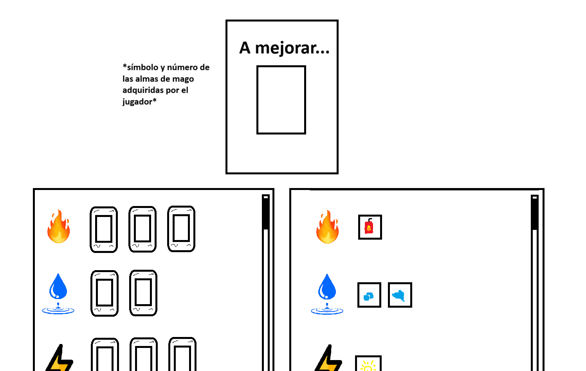

Al clicar en una bestia aparecerá un menú del siguiente estilo:

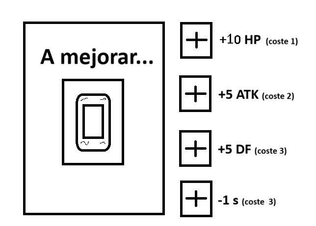

Al aumentar las estadísticas de la bestia el coste para volver a mejorarla aumentará en 1, siendo un aumento permanente.

Y al clicar en un equipamiento aparecerá otro que dependerá mucho más del propio equipamiento. Los equipamientos solo se podrán mejorar una vez.

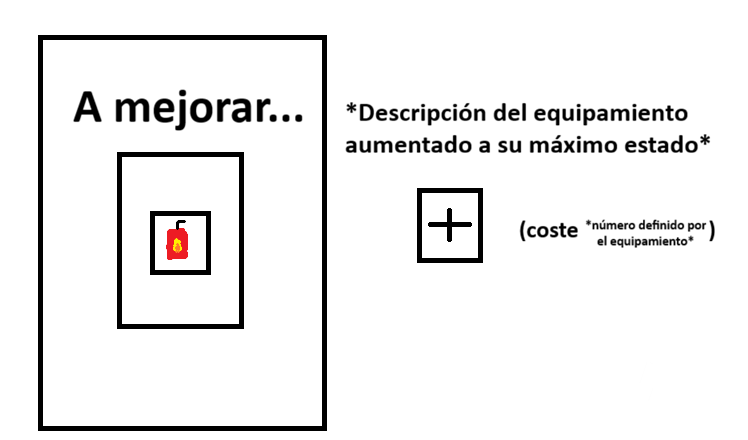

Una vez se mejore una bestia o un equipamiento no se podrá volver a seleccionar ninguna otra bestia o equipamiento.

### 4.11) Recurso de vidas y respawn

El jugador empezará con 3 vidas; al entrar a un combate podrá ser derrotado, perdiendo una vida.

Si aún no ha llegado a las 0 vidas, se le permite repetir el combate desde la [selección de bestias mágicas](#gdd-j5dd6sxpw5o), pudiendo cambiar su estrategia para volver a intentarlo.

### 4.12) Avance por el mapa y su generación.

Al finalizar un encuentro, el jugador elige a qué casilla del mapa avanzar (o avanza si es la única opción), pudiendo caer en diferentes tipos de casilla que darán lugar a diferentes eventos.

Un ejemplo de un mapa podría ser: 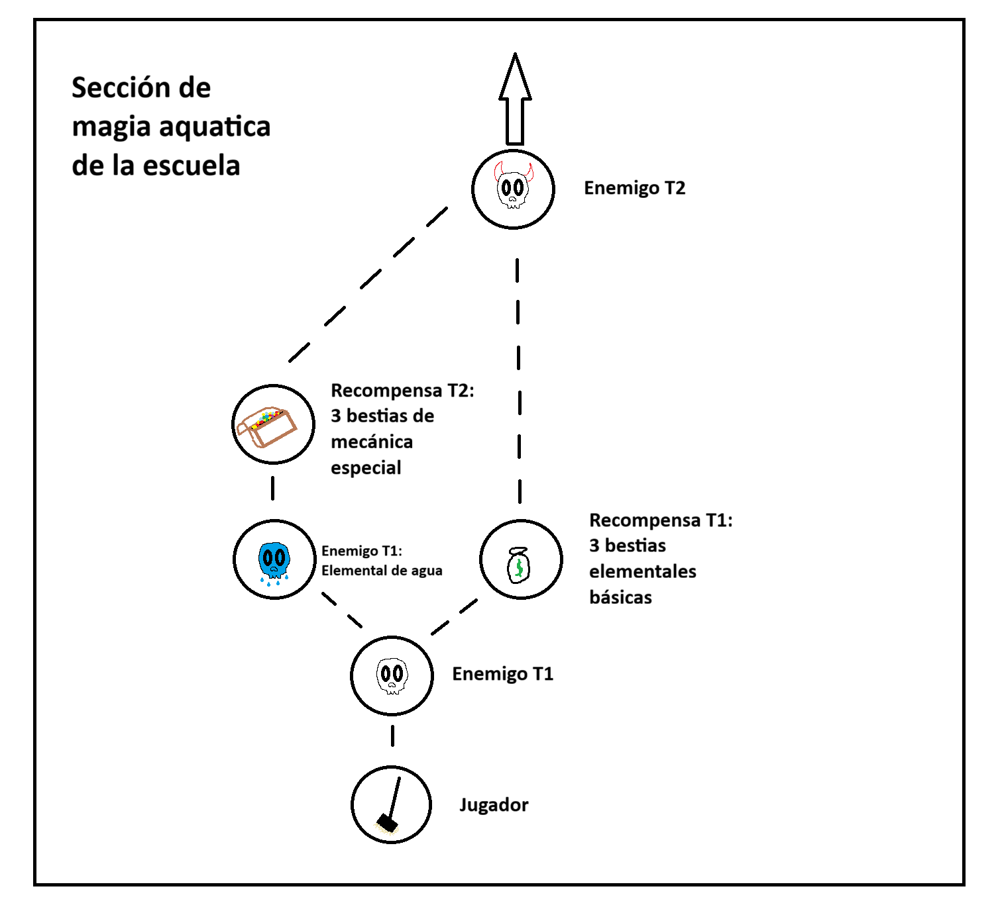

Aquí el jugador en primer lugar tendría que avanzar y luchar contra el enemigo, luego pudiendo elegir entre 2 caminos, clicando a cual se quiera ir.

El mapa tiene 2 elementos relevantes; **las secciones** a la que pertenecen y **las casillas** que contienen (con 2 tipos principales).

#### Secciones

Las secciones determinan diferentes zonas temáticas del juego; en el ejemplo estaría la temática de la sección de magia acuática de la escuela. Se caracterizaría por tener una mayor cantidad de encuentros con bestias de tipo agua.

La forma en la que esto se conseguirá será mediante el diseño de **una pool de combates** para cada zona, que se describe en [Casillas de enemigos](#gdd-gcosh17fbmb).

Cada sección tendrá diseñada una variedad concreta de mapas con diferentes casillas de enemigos y recompensas, determinadas por **tiers.** Al comenzar la partida se escogerá uno de los mapas diseñados para esa sección al azar.

Luego las casillas serán “rellenadas” al azar entre las posibles que hay diseñadas para esos tiers: por ejemplo, uno de nuestros mapas contiene en primer lugar un [enemigo de T1](#gdd-qh7adlnnfsz3) y al azar se puede decidir entre que sea un encuentro normal o uno elemental.

Lo mismo pasaría para las casillas de recompensa.

#### Casillas de enemigos

Al entrar a una casilla de enemigo empezará un combate, llevando al jugador a la [selección de bestias mágicas.](#gdd-j5dd6sxpw5o)

El juego tendrá diseñado una **“pool de encuentros”** para las diferentes [secciones](#gdd-77ock3h7woak) con combates para cada posible encuentro de cada tier.

Esto quiere decir que, al generarse una casilla de enemigos (cuyo tier viene definido por el mapa que haya tocado al azar), se escogerá en primer lugar el **tipo de encuentro** que se dará, y luego se escogerá entre la **pool de encuentros** definida para esa **sección en concreto.**

Una vez realizado un combate no podrá volver a salir en la misma partida.

##### Tier 1

Caracterizados por ser sencillos, luchando contra un equipo de enemigos, cuyo líder no participa en el combate.

Se definen:

- **Encuentros normales**: batalla contra un equipo de hasta 5 bestias sin ninguna temática especial. Serán relativamente sencillos.

- **Encuentros elementales**: batalla contra un equipo de hasta 5 bestias con una temática elemental; en el ejemplo podría ser el de elementales de agua.

##### Tier 2

Comienzan a ser más complicados, pueden:

1\) Combates contra equipos de bestia, con el mismo pentágono que el del jugador.

2\) Combates contra un solo gran enemigo, sin haber un líder.

3\) Combates donde el líder del equipo enemigo tenga alguna capacidad que afecte al combate.

Los diseños de estos combates estarán pensados para que contengan alguna estrategia que el enemigo use.

Se definen:

- **Encuentros normales:** batalla contra un equipo de 5 bestias sin ninguna temática especial. La composición del equipo definirá alguna estrategia simple.

- **Encuentros elementales**: batalla contra un equipo de 5 bestias con una temática elemental. Usarán al menos una criatura que tenga sinergía elemental, y podrán o no usar alguna estrategia simple.

- **Encuentros contra líderes ligeramente hábiles**: esencialmente batallas normales pero el líder participa en el combate de alguna forma pasiva; por ejemplo curando a sus bestias, atacando a las tuyas con magia…

- **Encuentros contra una gran bestia**: batalla contra un solo gran enemigo, diseñado para poner a prueba estrategias del jugador. Por ejemplo, que fuercen al jugador a tener una gran cantidad de daño por golpe en varias bestias, debido a una defensa alta del gran enemigo.

##### Tier 3

Estos combates serán realmente complicados, y pondremos específicamente enemigos que tengan un poder desbalanceado respecto al del jugador.

La ventaja del jugador para vencerlos será poder ver su estrategia en la fase de elección y reaccionar ante ella.

Se definen:

- **Encuentros normales**. Batalla contra un equipo de 5 bestias sin ninguna temática especial. La composición de equipo con bestias poderosas para construir una estrategia.

- **Encuentros elementales**: batalla contra un equipo de 5 bestias con una temática elemental. Usarán bestias poderosas y otras con sinergías elementales.

- **Encuentros contra líderes muy hábiles**: batalla contra un equipo de 5 bestias y un líder que tiene una habilidad que determina activamente el combate, como podría ser la resurrección de bestias.

##### Jefe

Una casilla especial para indicar el combate contra un jefe, siendo un combate que no contiene ninguna elección al azar (siempre el mismo según la sección).

Diseñados para suponer un verdadero desafío.

#### Casillas de recompensas.

Las casillas de recompensa tendrán una generación **casi igual** a la de las casillas de enemigos, con tiers y diferentes posibles generaciones para estos tiers. **Se diferencian** en que las recompensas **no dependen de la sección**, si no del [**nivel de aura.**](#gdd-q4ym4w5ph4za)

En concreto, siempre que se de a elegir será entre 3 recompensas, pudiendo elegir 2.

Las recompensas dadas a elegir serán prediseñadas, y no al azar, para garantizar variedad.

##### Tier 1

Son recompensas básicas para darle más variedad al jugador y que pueda empezar a construir una build, sin llegar a dar las piezas claves para la estrategia.

Se definen:

- **Recompensa de 3 bestias básicas**: da a escoger entre 3 bestias que tengan estadísticas básicas y mecánicas no muy relevantes.

- **Recompensa de 3 bestias elementales básicas:** da a escoger entre 3 bestias del mismo tipo elemental, con posibilidad de tener alguna mecánica de sinergia elemental más débil.

- **Recompensa de 3 equipamientos básicos:** da a escoger entre 3 equipamientos que no cambien drásticamente las estadísticas.

##### Tier 2

Estas son recompensas mejores que permiten al jugador obtener bestias con mecánicas especiales para empezar a formar una estrategia concreta.

Se definen:

- **Recompensa de 3 bestias de mecánica especial**: da a escoger entre 3 bestias que tengan mecánicas relevantes para el combate.

- **Recompensa de 3 equipamientos decentes:** da a escoger entre 3 equipamientos que al equiparlos consigan que una bestia básica del tier 1 sea significativamente mejor.

- **Recompensa de boost de criaturas simples:** se podrá seleccionar **una sola criatura** cualquiera de tu mazo y usar las [almas de mago](#gdd-xx1j5r113b1k) para mejorar ligeramente sus estadísticas, con diferentes precios para HP, daño, defensa y velocidad de ataque.

##### Tier 3

Estas son recompensas muy raras que dan a elegir bestias con estadísticas significativamente superiores o mecánicas potentes que puedan cambiar la torna de los combates por sí mismas.

Se define:

- **Recompensa de 3 bestias poderosas:** da a escoger entre 3 bestias que puedan ser o muy poderosas por sus estadísticas o muy poderosas por sus mecánicas.

- **Recompensa de boost de criaturas avanzado:** se podrá seleccionar **una sola criatura** cualquiera de tu mazo y usar las [almas de mago](#gdd-xx1j5r113b1k) para copiar y añadirle la [mecánica especial](#gdd-tq4lqjhk6z9f) de otra criatura en tu mazo.

## 5. Mundo del juego y contenido

### 5.1) Personajes.

// Algunos enemigos de la historia serán relevantes, falta definirlos.

#### The janitor

#### Protagonista del juego, es el encargado de descifrar lo que ocultan los asaltadores y el personaje con el que jugarás a lo largo del juego

#### Rata comecables.

Personaje humanoide que actúa como enemigo que vuelve una y otra vez en diferentes encuentros, molestando al jugador con diálogos burlescos.

#### El director (Jefe Final).

En la historia se revela que los atacantes de la escuela son súbditos del director, un demonio que busca crear un ejército aún mayor, eliminando a los débiles de la escuela y consiguiendo que solo sobrevivan los fuertes para en el futuro manipularlos y que se unan a él.

### 5.2) Bestias mágicas y equipamientos.

#### Bestias mágicas (cartas)

##### Tipo agua

- *Aqua Blob*

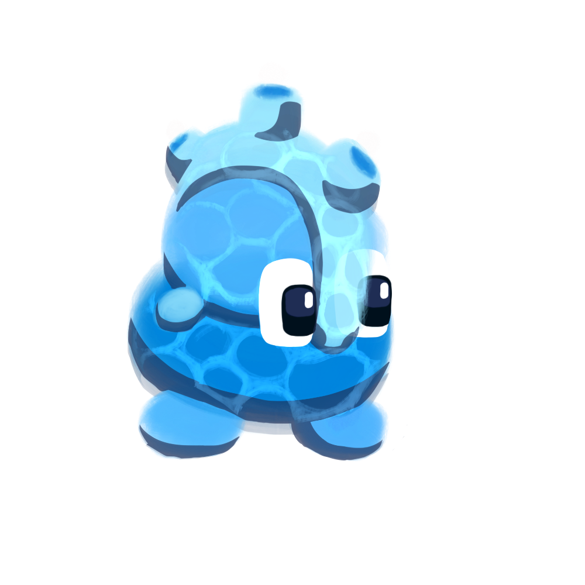

Su propósito es ser el “soldado raso” de **tipo agua**.

Estadísticas:

75 HP  -  10  ATQ  -  0 DEF  -  5 Seg

Puede tener equipamiento.

Su ataque es por defecto.

- *Kraken*

Su propósito es poder atacar a las bestias de la retaguardia del pentágono rival.

Estadísticas:

105 HP  -  20  ATQ  -  0 DEF   -  9 Seg

Usa la mecánica “[ataque desde atrás](#gdd-uj4v8fsdfdo2)”.

No puede tener equipamiento.

Su ataque es por defecto, añadiendo los ataques desde atrás.

- *Barca Pirata*

Su propósito es aportar más movimiento a tu pentágono permitiéndote girar más veces.

Estadísticas:

55 HP  -  25  ATQ  -  0 DEF   -  5 Seg

Utiliza la mecánica de “[alterar cooldown de rotación del pentágono](#gdd-f6fad2ycx2nu)” reduciendo en 2 segundos el tiempo de rotación de tu pentágono, hasta un mínimo de 1.

No puede tener equipamiento.

Su ataque es por defecto.

- *Oráculo de las mareas*

Su propósito es generar mucho movimiento en los pentágonos para poder tener más control de la posición de todas las bestias del rival.

Estadísticas:

75 HP  -  5  ATQ  -  0 DEF   -  5 Seg

Utiliza la mecánica de “[rotación del pentágono causada por bestia](#gdd-lyz2r62zwiq0)” ante el “[evento al rotar el pentágono](#gdd-e7noayvkirje)”, reaccionando solo con la rotación del jugador, girando el pentágono enemigo en sentido horario.

Puede tener equipamiento.

Su ataque es por defecto.

- *Horror Abisal*

Su propósito es romper la defensa rival, reduciendo la defensa de las criaturas.

Estadísticas:

75 HP  -  15  ATQ  -  0 DEF   -  5 Seg

Utiliza la mecánica de “[cambio de las estadísticas](#gdd-aps4pctqh0gy)” ante el “[evento al situarse en casillas](#gdd-x0w2n6zd2f08)”;

- En las posiciones del frente (1, 2 y 3), reduce 5 DEF a todas las bestias situadas en el frente (1, 2 y 3) de ambos pentágonos, hasta un mínimo de 0.

Puede tener equipamiento.

Su ataque es por defecto.

- *Sirena*

Su propósito es controlar el frente y crear sinergia elemental, reduciendo todo el daño que hagan las criaturas que no sean de **tipo agua.**

Estadísticas:

45 HP  -  10  ATQ  -  5 DEF   -  5 Seg

Utiliza la mecánica de “[cambio de las estadísticas](#gdd-aps4pctqh0gy)” reduciendo 5 ATQ a todas las bestias que no sean de tipo agua, hasta un mínimo de 1 (Posiciones 1, 2 y 3 de ambos pentágonos).

Puede tener equipamiento.

Su ataque es por defecto.

- *Leviathan, terror de las profundidades*

Su propósito es ser una bestia capaz de vencer al oponente, basándose en la rotación de tu pentágono generando sinergia con la rotación.

Estadísticas:

125 HP  -  20  ATQ  -  0 DEF   -  15 Seg

Utiliza la mecánica de “[ataque instantáneo](#gdd-fud6f2z1ytls)” ante el “[evento al rotar el pentágono](#gdd-e7noayvkirje)”, reaccionando solo con la rotación del jugador, atacando a todas las criaturas del oponente con 5 de ATQ.

Utiliza la mecánica de “[alterar cooldown de rotación del pentágono](#gdd-f6fad2ycx2nu)” aumentando en 2 segundos el tiempo de rotación de tu pentágono.

No puede tener equipamiento

Su ataque es por defecto.

- *Esponja de Mar*

Su propósito es ser un mini tanque que puede regenerarse generando sinergia con la rotación de tu pentágono.

Estadísticas:

60 HP - \~ ATQ - 5 DEF - \~ Seg

Utiliza la mecánica de “[curación](#gdd-8n71v396utis)” ante el “[evento al rotar el pentágono](#gdd-e7noayvkirje)”, recibiendo 5 HP cada vez que giras tu pentágono.

Utiliza la mecánica de “[incapacidad para atacar](#gdd-dy1t0mxemqzg)” por lo que no puede atacar. Por ello también usa la mecánica de “[bloqueo de las estadísticas](#gdd-sqppluj5nman)” para el ataque y su cooldown.

Puede tener equipamiento.

##### Tipo fuego

- *Slime de lava*

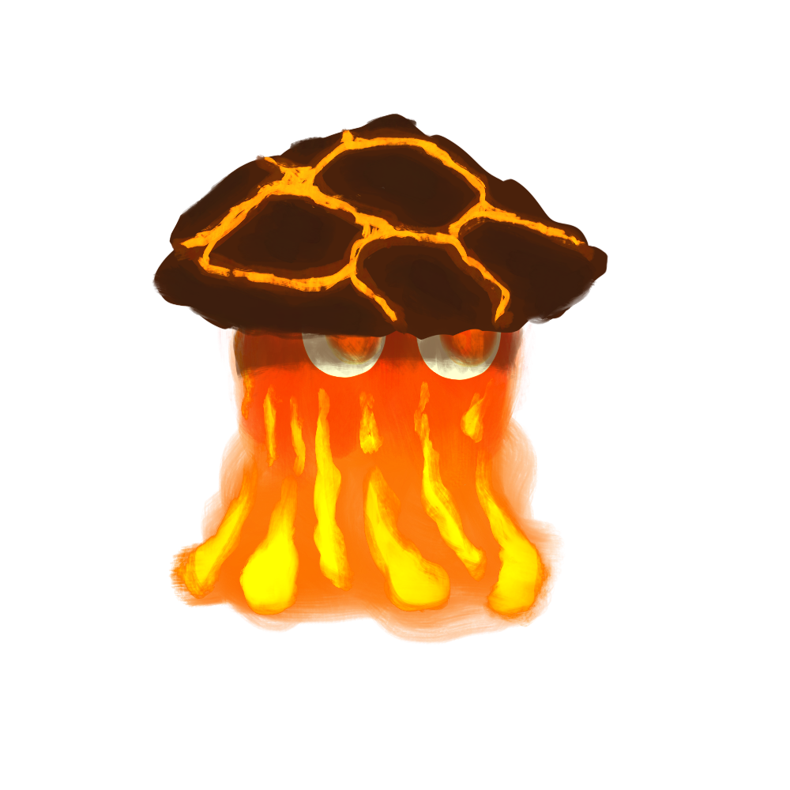

Su propósito es ser el “soldado raso” de **tipo fuego**.

Estadísticas:

50 HP  -  20 ATQ -  0 DEF -  5 Seg.

Puede tener equipamiento.

Su ataque es por defecto.

- *Cerbero*

Su propósito es ser un “glass cannon”, realizando grandes cantidades de daño pero a la vez siendo muy frágil.

Estadísticas:

75 HP - 10 ATQ - 0 DEF - 4 Seg.

Utiliza la mecánica de “[ataque triple](#gdd-yq24fwei0ubi)”.

Utiliza la mecánica de “[incapacidad de hacer daño a domadores](#gdd-px998nq5ty5q)”.

No puede tener equipamiento.

Su ataque es por defecto (excepto por el ataque triple).

- *El Horno*

Su propósito es proporcionar una “win condition” a equipos centrados en la defensa, con otra bestia estilo tanque cuyo daño va creciendo con el tiempo.

Estadísticas:

100 HP - 5 ATQ - 10 DEF - 20 Seg.

Utiliza la mecánica de “[cambio de estadísticas](#gdd-aps4pctqh0gy)” - Aumenta su ataque en **5** ante el “[evento al atacar](#gdd-2aa3yyi3rlx)”.

No puede tener equipamientos.

Su ataque es por defecto.

- *Ave Fénix*

Proporciona una bestia centrada en respawnear, dando una bestia que fomenta rotar el pentágono (para esperar su cooldown detrás) y siendo muy versátil; puede servir de “esponja” (ya que el daño de “overkill” no se usa, por ejemplo con 5 HP recibir 20 de daño, esos 15 extra no harían nada) o puede tener más utilidad recibiendo bufos o equipamientos.

Estadísticas:

40 HP - 10 ATQ - 0 DEF - 5 Seg.

Utiliza la mecánica de “[resurrección de bestias](#gdd-3qaak06pykcr)”, con un cooldown de **15** segundos.

Puede tener equipamientos.

Su ataque es por defecto.

- *Leon de Fuego*

Su propósito es crear sinergia elemental, bufando a las bestias de su mismo tipo; el fuego. Es versátil, pudiendo estar tanto adelante como atrás, teniendo su mayor potencia en equipos de al menos 4 bestias de tipo fuego pero siendo útil con 3 o 2.

Estadísticas:

110 HP - 20 ATQ - 0 DEF - 7.5 Seg.

Utiliza la mecánica de “[cambio de estadísticas](#gdd-aps4pctqh0gy)”, añadiendo **5 de ATQ** a todas las aliadas **DEL TIPO FUEGO** en las posiciones delanteras (1, 2 y 3). Independientemente de su posición en el pentágono.

NOTA: No se puede buffear a sí mismo, solo bestias aliadas. 

No puede tener equipamientos.

Su ataque es por defecto.

- *Taurox*

Su función es contrarrestar a estrategias que utilicen mucha defensa, reduciendo progresivamente la vida de las bestias. Por otra parte es improbable que ataque repetidamente al mismo enemigo, justificando sus estadísticas.

Estadísticas:

100 HP - 30 ATQ - 0 DEF - 12 Seg.

Utiliza la mecánica de “[ataque según la vida](#gdd-8zv7t2o6qrkj)”, atacando en las posiciones de ataque por defecto.

Utiliza la mecánica de “[daño penetrante](#gdd-uxohuok13vtd)”.

No puede tener equipamiento.

Su ataque está completamente determinado por la mecánica de ataque según la vida.

- *Ifrit*

Su función es ser la criatura a la que quieres que vayan todos los bufos posibles, fomentando una estrategia centralizada en ella para ganar. Al tener ataque por defecto su daño penetrante puede ser realmente efectivo.

Estadísticas:

80 HP - 0 ATQ - 0 DEF - 4 Seg.

Utiliza la mecánica de “[daño penetrante](#gdd-uxohuok13vtd)”.

Puede tener equipamiento.

Su ataque es por defecto.

- *Apolo, Dios del Sol*

Su función es ser una bestia bufadora de criaturas, añadiendo una gran cantidad de daño, pero teniendo la desventaja de dañarlas.

Estadísticas:

130 HP - 40 ATQ - 0 DEF - 12 Seg.

Utiliza la mecánica de “[cambio de estadísticas](#gdd-aps4pctqh0gy)”, añadiendo **10 de ATQ** a las **2 bestias adyacentes a su posición.**

Utiliza la mecánica de “[daño a los aliados](#gdd-tfiq8s4vwc79)”, realizando **10 de** [**daño penetrante**](#gdd-uxohuok13vtd) a las **2 bestias adyacentes a su posición** cada 10 segundos.

No puede tener equipamiento.

Su ataque es por defecto.

##### Tipo aire

- *Smoke Puff*

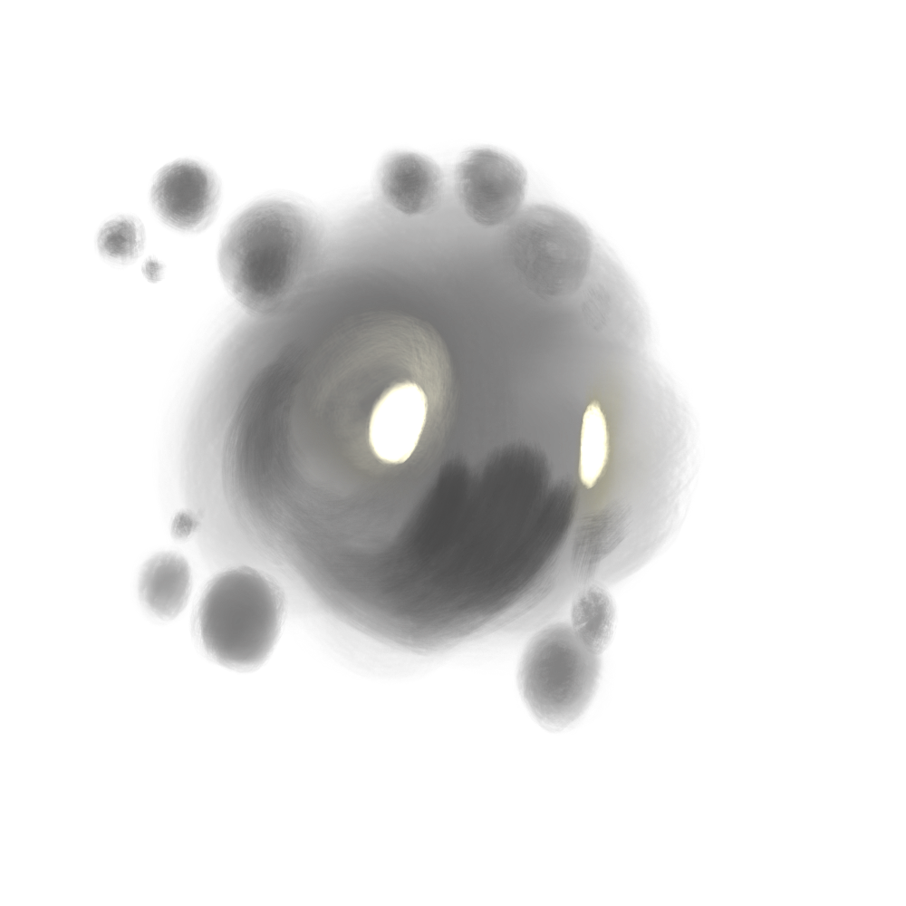

Su propósito es ser el “soldado raso” de **tipo aire**.

Estadísticas:

50 HP  -  10 ATQ -  5 DEF -  5 Seg.

Puede tener equipamiento.

Su ataque es por defecto

- *Grifo*

Su propósito es ser una bestia altamente peligrosa en el frente, que castiga tener bestias “pasivas” en el frente de batalla, realizando daño directamente a la vida del oponente.

Estadísticas:

90 HP  -  10 ATQ -  0 DEF -  10 Seg.

Usa la mecánica de “[daño directo](#gdd-3kb0uoa95kj1)”.

Puede tener equipamiento.

Su ataque es por defecto.

- *Djinn*

Su función es ser una bestia versátil que encaje en múltiples estrategias, a su vez permitiendo el cambio de dinámica de la bestia en pleno combate (pasando de tanque a agresivo).

Estadísticas:

75 HP  -  0 ATQ -  0 DEF -  6 Seg.

Usa la mecánica de “[cambio de las estadísticas](#gdd-aps4pctqh0gy)” en función de su posición:

Posición 1: +15 ATQ, +5 DEF.

Posición 2: +10 ATQ, +10 DEF.

Posición 3: +5 ATQ, +15 DEF.

NOTA: Al cambiar de posición el bufo de estadísticas cambia (no “suma más”).

No puede tener equipamientos.

Su ataque es por defecto.

- *Pegaso*

Su función es ser una bestia de alto daño con la capacidad de contrarrestar bestias débiles en la parte trasera para hacer daño al oponente o evitar que tengan otros efectos (por ejemplo eliminar a un curador).

Estadísticas:

50 HP  -  15 ATQ -  0 DEF -  4.5 Seg.

Usa la mecánica de “[ataque desde atrás](#gdd-uj4v8fsdfdo2)”.

Puede tener equipamientos.

Su ataque será una combinación del por defecto con la mecánica de ataque desde atrás.

- *Hada*

Su función es contrarrestar equipos que tengan defensa baja, a su vez permitiendo atacar de forma general a la parte trasera del equipo rival.

Estadísticas:

50 HP  -  5 ATQ -  10 DEF -  5 Seg.

Usa la mecánica de “[ataque global](#gdd-n38xhg1x4nax)”.

Usa la mecánica de “[ataque desde atrás](#gdd-uj4v8fsdfdo2)” (combinado con la de ataque global, atacando a todos).

No puede tener equipamiento.

Su ataque viene definido por sus mecánicas, combinando el por defecto junto al ataque desde atrás y el ataque global.

- *Arcangel portador de la espada*

Su función es ser una bestia que hace sinergia dentro del propio elemento, sirviendo como “win condition” que consigue su máximo potencial tras morir varias bestias.

Estadísticas:

100 HP  -  5 ATQ -  5 DEF -  8 Seg

Utiliza la mecánica de “[evento de muerte](#gdd-zg0zijtev6o)”, obteniendo **5 de ATQ** cada vez que muere una criatura. Si la criatura muerta es aliada y de **TIPO AIRE**, recibe **10 de ATQ** en su lugar.

No puede tener equipamiento.

Su ataque es por defecto.

- *Querubín, protector del Edén*

Su propósito es ser una protección completa para el daño que fuese a hacerse al jugador.

Estadísticas:

100 HP  -  15 ATQ -  10 DEF -  10 Seg.

Usa la mecánica “[protección contra daños](#gdd-x9yo7ebh7bzm)” previniendo todo el daño que se le fuera a hacer al domador que lo controla y se le hace el daño a esta criatura en su lugar.

No puede tener equipamiento.

Su ataque es por defecto.

- *Torbellino*

Su propósito es crear sinergia elemental y hacerse fuerte, aumentando sus estadísticas de acuerdo a cuantas más bestias tienes en tu equipo que sean de **tipo aire**.

Estadísticas:

65 HP  -  10 ATQ -  5 DEF -  7 Seg.

Usa la mecánica de “[cambio de las estadísticas](#gdd-aps4pctqh0gy)”, recibiendo **al inicio del combate** un aumento de **5 ATQ y 10 HP** por cada bestia aliada **DEL TIPO AIRE** en tu equipo.

NOTA: No recibe bonificación “por sí mismo”, ha de ser una bestia aliada

No puede tener equipamiento.

Su ataque es por defecto.

##### Tipo tierra

- *Golem de Tierra*

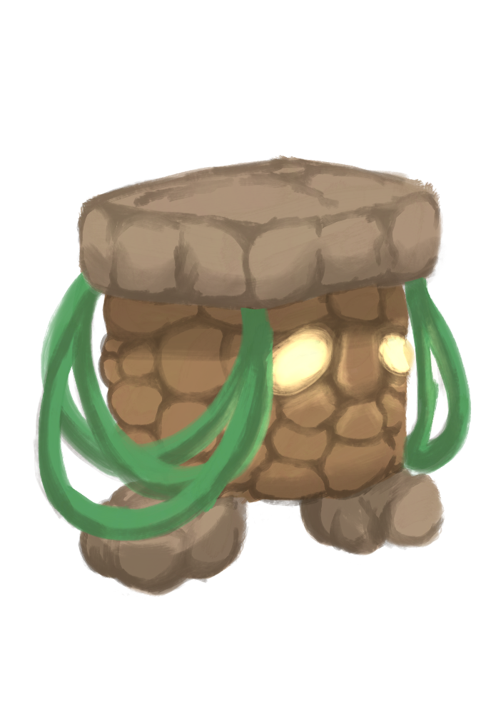

Su propósito es ser el “soldado raso” de **tipo tierra**.

Estadísticas:

70 HP  -  15 ATQ -  5 DEF -  8 Seg

Puede tener equipamiento.

Su ataque es por defecto.

- *Oveja de piedra*

Su propósito es ser un tanque fácil de obtener para resistir las grandes bestias enemigas.

Estadísticas:

15 HP  -  5 ATQ -  30 DEF -  5 Seg

Puede tener equipamiento.

Su ataque es por defecto.

- *Hydra*

Su propósito es tener un alto ataque y sobrevivir mediante su curación, fomentando la rotación del pentágono.

Estadísticas:

60 HP  -  15 ATQ -  0 DEF - 5 Seg

Usa la mecánica de ”[apagado y encendido de mecánicas](#gdd-t48ij5rni1wn)” ante el “[evento al situarse en casillas](#gdd-x0w2n6zd2f08)”, activando o desactivando la mecánica de “[curación](#gdd-8n71v396utis)”:

- Para las posiciones traseras (4 y 5): activa la curación, recibiendo 10 de HP cada 6 segundos solo si está en la retaguardia.

- Para las posiciones delanteras (1, 2 y 3): desactiva la curación.

Puede tener equipamiento.

Su ataque es por defecto.

- *Medusa*

Su propósito es ser una apuesta arriesgada que nos sirva para poder matar a una bestia enemiga pero arriesgándose a perder una de las nuestras.

Estadísticas:

40 HP  -  \~ ATQ -  0 DEF -  15 Seg

Usa la mecánica de “[toque de la muerte](#gdd-fmdj52s1x37u)”.

Usa la mecánica de “[incapacidad de hacer daño a domadores](#gdd-px998nq5ty5q)”.

No puede tener equipamiento.

Su ataque es por defecto.

- *Gárgola de piedra*

Su función es contrarrestar a los enemigos que atacan realizando poco daño, con un contraataque poderoso.

Estadísticas:

75 HP  -  15 ATQ -  10 DEF -  \~ Seg

Utiliza la mecánica de “[reflejo del daño](#gdd-v90qzcnh7to)”, realizando daño a la bestia atacante igual al ATQ de la Gárgola de piedra.

Utiliza la mecánica de “[incapacidad para atacar](#gdd-dy1t0mxemqzg)” por lo que no puede atacar.

Utiliza la mecánica “[bloqueo de las estadísticas](#gdd-sqppluj5nman)” para los segundos de cooldown de ataque.

No puede tener equipamiento.

No puede atacar.

- *Hecatonquiros*

Su función es ser una bestia versátil para que pueda tener estadísticas variadas y muy diferentes.

Estadísticas:

50 HP  -  0 ATQ -  0 DEF -  6.5 Seg

Usa la mecánica de “[cambio de las estadísticas](#gdd-aps4pctqh0gy)”, añadiendo las estadísticas (**excepto el cooldown de ataque)** que tiene la criatura adyacente a contrarreloj, y restando las estadísticas **(excepto el cooldown de ataque)** de la criatura adyacente al reloj, con un mínimo de 1 para cada estadística.

No puede usar equipamiento.

Su ataque es por defecto.

- *Protector de la Tierra, Atlas*

Su propósito es ser una protección completa para el daño que fuese a hacerse a tus bestias.

Estadísticas:

230 HP  -  \~ ATQ -  0 DEF -  \~ Seg

Usa la mecánica “[protección contra daños](#gdd-x9yo7ebh7bzm)” previniendo todo el daño que se le fuera a hacer a las criaturas que lo controlas y se le hace el daño a esta criatura en su lugar.

No puede tener equipamiento.

Utiliza la mecánica de “[incapacidad para atacar](#gdd-dy1t0mxemqzg)” por lo que no puede atacar.

- *Tifón*

Su función es cambiar completamente el panorama y convertir la defensa en ataque para poder usar a tus tanques como atacantes.

Estadísticas:

100 HP  -  5 ATQ -  25 DEF -  10 Seg

Usa la mecánica “[intercambio de estadísticas](#gdd-1qqcmpjrksrb)” ante el “[evento al situarse en casillas](#gdd-x0w2n6zd2f08)” cuando esta criatura está en el frente (1, 2 y 3), intercambia las estadísticas de ATQ y DEF de todas tus criaturas. Al regresar a la parte trasera (4, 5), vuelve a invertirlas.

No puede usar equipamiento.

Su ataque es por defecto.

##### Tipo electricidad

- *Electro Spirit*

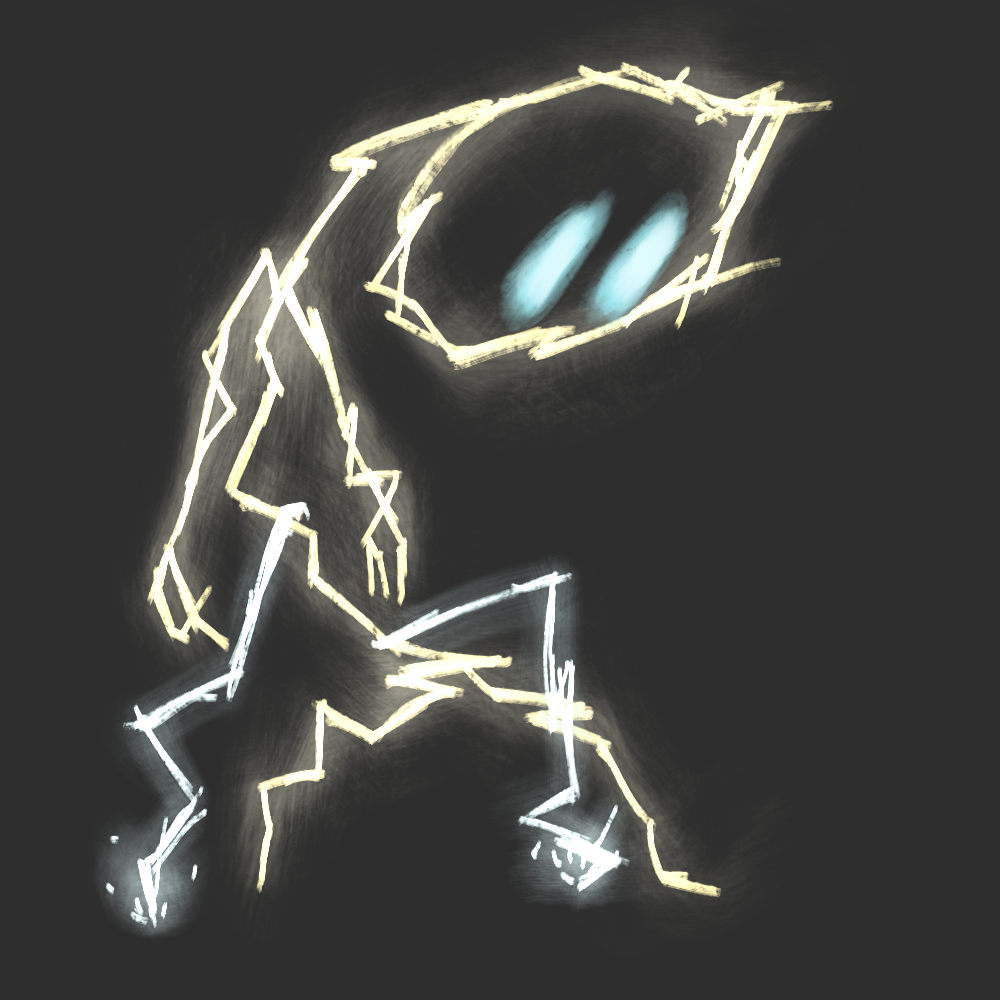

Su propósito es ser el “soldado raso” de **tipo rayo**.

Estadísticas:

50 HP  -  10 ATQ -  0 DEF -  3 Seg

Puede tener equipamiento.

Su ataque es por defecto.

- *Chispas*

Esta bestia sirve para contrarrestar enemigos que atacan fuerte pero muy lento, pudiendo ralentizar su ataque, y si se requiere, rotar antes de recibir su ataque para evitar que Chispas reciba daño.

Estadísticas:

80 HP  -  5 ATQ -  0 DEF -  3.5 Seg

Usa la mecánica de “[ralentización de ataques](#gdd-sczx6284y6wm)” con el “[evento al atacar](#gdd-2aa3yyi3rlx)”, haciendo que el ataque de la bestia enemiga afectada tarde **1 seg** más en realizarse cada vez que le golpea.

Puede tener equipamiento.

Su ataque es por defecto.

- *Acelerador de partículas*

Es una bestia que hace counter a estrategias con grandes tanques que no realizan daño, consiguiendo acelerar su ataque a velocidades ridículas.

Estadísticas:

90 HP  -  5 ATQ -  0 DEF -  8 Seg

Usa la mecánica de “[cambio de estadísticas](#gdd-aps4pctqh0gy)” ante el “[evento al atacar](#gdd-2aa3yyi3rlx)”, disminuyendo su cooldown de ataque en 1 segundo, hasta un mínimo total de 1 segundo.

Puede tener equipamiento.

Su ataque es por defecto.

- *Elefante eléctrico*

Se trata de una bestia tanque de ataque lento capaz de asesinar a otras bestias en la retaguardia, haciendo counter a estrategias que necesiten su supervivencia.

Estadísticas:

140 HP  -  20 ATQ -  0 DEF -  15 Seg

Usa la mecánica de “[ataque penetrante](#gdd-dbz27z21jftu)”.

No puede tener equipamiento.

Su ataque es por defecto.

- *Seth, Dios de las Tormentas*

Se trata de una bestia poderosa, con un ataque rápido y gran defensa capaz de dañar a todas las bestias rivales. A cambio ralentiza significativamente los ataques de tus bestias, teniendo cierta sinergia elemental con el rayo ya que muchas de sus bestias están centradas en mitigar este efecto.

Estadísticas:

125 HP  -  15 ATQ -  10 DEF -  7 Seg

Usa la mecánica de “[ataque global](#gdd-n38xhg1x4nax)”.

Usa la mecánica de “[cambio de estadísticas](#gdd-aps4pctqh0gy)”, aumentando el cooldown de ataque de las bestias aliadas en 3 segundos.

NOTA: No aumenta su propio cooldown.

No puede tener equipamiento.

Su ataque es por defecto, añadiendo el efecto del ataque global.

- *Maestro de las baratijas*

Es una bestia versátil que cumple una variedad de funcionalidades dependiendo de su posición.

Estadísticas:

65 HP  -  5 ATQ -  5 DEF -  5 Seg

Usa la mecánica de “[cambio de las estadísticas](#gdd-aps4pctqh0gy)” con el “[evento al situarse en casillas](#gdd-x0w2n6zd2f08)”:

- Si está en la posición 5, añade 5 de ATQ a la bestia en la posición 2.

- Si está en la posición 4, añade 5 de DEF a la bestia en la posición 2.

Usa la mecánica de “[Apagado y encendido de mecánicas](#gdd-t48ij5rni1wn)”con el “[evento al situarse en casillas](#gdd-x0w2n6zd2f08)”:

- Si está en la posición 2 y solo en la posición 2, activa la mecánica de “[Ataque penetrante](#gdd-dbz27z21jftu)”.

- Si está en las posiciones 1 y 3 y solo en estas, empezará a usar “[Daño penetrante](#gdd-uxohuok13vtd)”

Puede tener equipamientos.

Su ataque es por defecto.

- *Relojero Maestro*

Se trata de una bestia pensada para aumentar la velocidad de ataque y que fomente al jugador a querer tenerla en la retaguardia para que no muera.

Estadísticas:

50 HP  -  5 ATQ -  5 DEF -  5 Seg

Usa la mecánica de “[cambio de estadísticas](#gdd-aps4pctqh0gy)”, al iniciar el combate, disminuyendo el cooldown de ataque de las bestias aliadas en 2 segundos. Además, el “[evento de muerte](#gdd-zg0zijtev6o)”, aumenta el cooldown de ataque de las bestias aliadas en 2 segundos.

**NOTA**: Esto significa que además de perder los 2 segundos de reducción, se añaden otros 2 segundos adicionales al morir.

No puede tener equipamientos.

Su ataque es por defecto.

- *Fenrir*

Su función es contrarrestar a estrategias de criaturas con mucha vida, reduciendo progresivamente la vida de las bestias. Por otra parte es improbable que ataque repetidamente al mismo enemigo, justificando sus estadísticas.

Estadísticas:

80 HP - 30 ATQ - 0 DEF - 6 Seg.

Utiliza la mecánica de “[ataque según la vida](#gdd-8zv7t2o6qrkj)”.

No puede tener equipamiento.

Su ataque es por defecto.

##### Tipo vida

- *Bestia enredadera*

Su función es ser una bestia capaz de vencer a bestias tanques con grandes cantidades de defensa, usando su propia vida y su curación para devolverles el daño recibido. Por otra parte, dificulta la rotación de tu pentágono significativamente.

Estadísticas:

60 HP  -  \~ ATQ -  5 DEF -  \~ Seg

Utiliza la mecánica “[incapacidad de atacar](#gdd-dy1t0mxemqzg)”, a su vez con la mecánica de “[bloqueo de estadísticas](#gdd-sqppluj5nman)” para el ataque y el cooldown de ataques.

Utiliza la mecánica de “[daño a los aliados](#gdd-tfiq8s4vwc79)” ante el “[evento al rotar el pentágono](#gdd-e7noayvkirje)”, realizando **20 de** [**daño penetrante**](#gdd-uxohuok13vtd) a las **2 bestias adyacentes a su posición**.

Utiliza la mecánica de “[reflejo del daño](#gdd-v90qzcnh7to)”, devolviendo la **cantidad de daño recibido** (incluyendo la reducción por la defensa de esta bestia; sería el cambio en la vida de la bestia enredadera) como “[**daño penetrante**](#gdd-uxohuok13vtd)**”**.

Utiliza la mecánica de “[curación](#gdd-8n71v396utis)”, recuperando 1 de HP cada 1 segundo.

No puede tener equipamientos.

- *Árbol sabio*

Se trata de un curandero obligado a estar en el frente de batalla, cumpliendo el papel de un tanque que no ataca.

Estadísticas:

100 HP  -  \~ ATQ -  10 DEF -  \~ Seg

Utiliza la mecánica “[incapacidad de atacar](#gdd-dy1t0mxemqzg)”, a su vez con la mecánica de “[bloqueo de estadísticas](#gdd-sqppluj5nman)” para el ataque y el cooldown de ataques.

Utiliza la mecánica de “[apagado y encendido de mecánicas](#gdd-t48ij5rni1wn)” para la mecánica de “[curación](#gdd-8n71v396utis)” ante el “[evento al situarse en casillas](#gdd-x0w2n6zd2f08)”:

- Para las posiciones 4 y 5 no habrá curación.

- Para las posiciones 1, 2 y 3, se curará a las bestias en las 3 posiciones delanteras (1, 2 y 3), recibiendo 5 de HP cada 5 segundos.

No puede tener equipamientos.

- *Gaia, Madre Tierra*

Se trata de un curandero fomentado para que permanezca en la retaguardia mientras cura constantemente al grupo.

Estadísticas:

70 HP  -  \~ ATQ -  0 DEF -  \~ Seg

Utiliza la mecánica “[incapacidad de atacar](#gdd-dy1t0mxemqzg)”, a su vez con la mecánica de “[bloqueo de estadísticas](#gdd-sqppluj5nman)” para el ataque y el cooldown de ataques.

Utiliza la mecánica de “[curación](#gdd-8n71v396utis)” recuperando 10 de HP cada 15 segundos a todas las bestias aliadas independientemente de su posición.

No puede tener equipamientos.

- *Leshen*

Se trata de un curandero obligado a estar en el frente de batalla, cumpliendo una función más agresiva para poder curar a tus criaturas.

Estadísticas:

75 HP  -  20 ATQ -  5 DEF -  10 Seg

Usa la mecánica de “[curación](#gdd-8n71v396utis)” ante el “[evento al atacar](#gdd-2aa3yyi3rlx)”, recuperando HP igual al ataque de Leshen a las bestias aliadas en el frente cada vez que ataca.

NOTA: No se cura a sí mismo, solo aliados.

Su ataque es por defecto.

No puede tener equipamientos.

- *Ninfa, espíritu del bosque*

Se trata de un curandero centrado en aportar una gran curación cuando una criatura muere, fomentando tanto estrategias muy agresivas como estrategias más pasivas.

Estadísticas:

80 HP  -  \~ ATQ -  0 DEF -  \~ Seg

Utiliza la mecánica “[incapacidad de atacar](#gdd-dy1t0mxemqzg)”, a su vez con la mecánica de “[bloqueo de estadísticas](#gdd-sqppluj5nman)” para el ataque y el cooldown de ataques.

Utiliza la mecánica de “[evento de muerte](#gdd-zg0zijtev6o)”, a su vez con la mecánica de “[curación](#gdd-8n71v396utis)” recuperando 25 HP a todas tus criaturas cada vez que otra criatura muere.

No puede tener equipamiento.

##### Tipo muerte

- *Aracne*

Su propósito es ser una bestia altamente peligrosa en el frente, que castiga tener bestias “pasivas” en el frente de batalla, realizando mucho daño directamente a la vida del oponente pero siendo el objetivo principal de todo el daño que se le fuese a hacer a las bestias.

Estadísticas:

100 HP  -  20 ATQ - 0 DEF -  10 Seg

Usa la mecánica de “[daño directo](#gdd-3kb0uoa95kj1)”.

Utiliza la mecánica de “[bloqueo de rotación del pentágono](#gdd-o7xmrl7pmz7s)” en ambos pentágonos mientras se encuentre en el frente.

Usa la mecánica “[protección contra daños](#gdd-x9yo7ebh7bzm)” previniendo todo el daño que se le fuera a hacer a las criaturas que lo controlas y se le hace el daño a esta criatura en su lugar

Su ataque es por defecto.

No puede tener equipamientos.

- *Hades, Dios del inframundo*

Se trata de una bestia que busca quemar poco a poco a las bestias enemigas, quitándoles lentamente vida a todas las criaturas para buscar cerrar partidas que puedan durar mucho por criaturas con defensas muy altas.

Estadísticas:

135 HP  -  1 ATQ - 0 DEF -  3 Seg

Utiliza la mecánica de “[bloqueo de estadísticas](#gdd-sqppluj5nman)” para el ataque, la defensa y el cooldown de ataques.

Usa la mecánica de “[ataque global](#gdd-n38xhg1x4nax)”.

Utiliza la mecánica de “[daño penetrante](#gdd-uxohuok13vtd)”.

Su ataque es por defecto.

No puede tener equipamientos.

- *Báihǔ*

Su propósito es ser un “glass cannon” con muy poca vida, realizando grandes cantidades de daño pero con la capacidad de recuperar vida dependiendo del daño que inflija.

Estadísticas:

30 HP  -  30 ATQ -  0 DEF -  6 Seg.

Usa la mecánica “[curación](#gdd-8n71v396utis)” para recuperar una cantidad de vida igual al daño que hace.

No puede tener equipamiento.

Su ataque es por defecto.

- *Wendigo*

Se trata de una muy versátil llegando a poder ser capaz de copiar a todas las criaturas, pero por ello es muy situacional y no utilizable con jefes únicos que no usan bestias.

Estadísticas:

\~ HP  -  \~ ATQ -  \~ DEF -  \~ Seg

Al inicio del combate, utiliza la mecánica de “[copiar bestia](#gdd-3z9svt8rhx1x)” copiando la bestia rival posicionada en la casilla opuesta del pentágono rival.

- Para las posiciones 1, 2, 3, 4 y 5 se aplicará la mecánica para las posiciones 1, 2, 3, 4 y 5 del pentágono rival.

Su ataque es por defecto.

No puede tener equipamientos.

- Bloodbath

Se trata de una bestia que busca ser el centro de atención para tu estrategia, sirviendo como un tanque en los turnos primeros del juego y tomando un papel mucho más agresivo después de crecer en ataque al ponerla en la retaguardia, fomentando también una estrategia de criaturas muy resistentes a su alto coste de crecimiento.

Estadísticas:

80 HP - 1 ATQ - 0 DEF - 3.5 Seg.

Utiliza la mecánica de “[ataque descontrolado](#gdd-1fx6s832b6jb)”, pudiendo atacarse a sí misma.

Utiliza la mecánica de “[Apagado y encendido de mecánicas](#gdd-t48ij5rni1wn)” ante el “[evento al situarse en casillas](#gdd-x0w2n6zd2f08)”:

- Para las posiciones traseras (4 y 5) y solo estas, activa la mecánica de “[curación](#gdd-8n71v396utis)” ante el “[evento al atacar](#gdd-2aa3yyi3rlx)”, recibiendo 2 de HP por cada bestia atacada, y activa la mecánica de “[daño penetrante](#gdd-uxohuok13vtd)”.

También activa la mecánica de “[cambio de las estadísticas](#gdd-aps4pctqh0gy)” ante el “[evento al atacar](#gdd-2aa3yyi3rlx)”, obteniendo 1 de ataque por cada bestia atacada (incluyéndose a sí misma).

Su ataque es la mezcla del por defecto junto al ataque descontrolado.

No puede tener equipamientos.

#### Equipamientos

Son mejoras que se pueden aplicar a las bestias que las permiten.

Solo se pueden aplicar al tipo correspondiente (equipamiento de agua con bestias de tipo agua)

##### Tipo agua

- Cubitos de hielo. Incrementan la defensa en 5. Tier 1.

- ?. Incrementa la vida en 15. Tier 2.

- ?. Incrementa el daño en 5. Tier 2.

- ?. Le añade a la bestia la mecánica de “[alterar el cooldown de rotación del pentágono](#gdd-f6fad2ycx2nu)”, disminuyendo este cooldown en 1 segundo, hasta un mínimo de 1.

##### Tipo fuego

- Combustible. Incrementa el ataque en 5.

- ?. Incrementa el daño en 5. Tier 1.

- ?. Incrementa la vida en 15. Tier 2.

- ?. Disminuye el cooldown de ataque en 1 segundo, hasta un mínimo de 1.

- ?. Incrementa el daño en 10. Tier 3.

##### Tipo aire

- Cigarro. Incrementa la vida en 10. Tier 1.

- ?. Incrementa la defensa en 5. Tier 2.

- ?. Incrementa el ataque en 5. Tier 2.

- ?. Incrementa la defensa en 10. Tier 3.

##### Tipo tierra

- Maceta: Incrementa la defensa en 5 Tier 1.

- ?. Incrementa la vida en 35, disminuye la defensa en 5 hasta un mínimo de 0. Tier 2.

- ?. Incrementa la vida en 10, aumenta la armadura en 5.

- ? Incrementa el daño en 15. Tier 3.

##### Tipo electricidad

- Cargador: Disminuye en 1s el cooldown de ataques, hasta un mínimo de 0.5s.

- ?. Incrementa el daño en 5. Tier 2.

- ?. Incrementa la vida en 10, aumenta la armadura en 5.

- ?.Aumenta el daño en 5 y disminuye el cooldown de ataques en 1s, hasta un mínimo de 0.5s. Tier 3.

### 5.3) Obstáculos.

#### Peligros ambientales.

Algunas posiciones de los pentágonos de las bestias contendrán peligros ambientales de los diferentes tipos elementales; estos realizarán 5 de daño de ese tipo cada 2 segundos a las bestias que están posicionadas encima. Si la bestia es del mismo tipo, no recibirá daño.

Estas intentarán hacer daño (solo a bestias) independientemente de que haya una encima o no; es decir, tendrán su build-up de hasta 2 segundos y realizará el daño si en ese instante tiene a una bestia encima, independientemente de que el jugador haga rotaciones o no.

Los peligros ambientales **no rotan** junto a los pentágonos de los equipos, y **siempre aparecen en forma “espejo”** en los combates contra enemigos con equipos de bestias, es decir, si hay un peligro ambiental en la parte trasera superior de tu pentágono, el enemigo también tendrá ese mismo peligro ambiental en su parte trasera superior.

### 5.4) Entornos y contenido respecto a enemigos

// Aquí van los diferentes entornos que diseñaremos junto a sus encuentros para los diferentes tiers en las casillas de enemigos.

#### Entornos y sus encuentros.

La progresión del juego abarcará seis secciones distinguibles, cinco de ellas contarán con una identidad elemental notoria.

- **Primera zona - Pasillos de la escuela**

La rest

- **Segunda zona - Los baños, zona de taquillas y duchas (TIPO AGUA)**

La

- **Tercera zona - Sala de servidores(TIPO ELECTRICIDAD)**

La

- **Cuarta zona - Patio rocoso (TIPO TIERRA)**

La

- **Quinta zona - Azotea (TIPO AIRE)**

La

- **Sexta zona - Despacho del director (TIPO FUEGO)**

La

#### Líderes enemigos con habilidades

RATA COME CABLES (ELECTRICIDAD)

DIRECTOR(DEMONIO)

## 6. Interfaz

### 6.1) Cámara

Solamente activa durante el combate. Esta será estática en vista top-down, mostrando todo lo que está pasando en la pelea, incluyendo a los líderes, bestias en el frente de combate y bestias que están inactivas detrás del frente.

### 6.2) HUD

Se mostrará toda la información relevante para el combate, la cual sería: hp de todas las bestias, de los líderes, el tiempo que le falta a cada bestia para atacar (junto a su herramienta) y tras girar la rueda se mostrará el tiempo de bloqueo de rueda y lo que queda para poder volver a girarla.

### 6.3) Menús

Habrán 3 menús principales:

- **Menú de inicio de juego**, el cual sale al arrancar el juego y te permite cambiar ajustes y dificultad

- **Menú de entre batalla**, el cual se usará para elegir tus bestias, el orden de estas en el pentágono, y qué equipamiento llevarán al combate. Habrá un botón que te permita accionar el combate y otro que te lleve al menú principal

- **Menú de pausa**, se podrá acceder a él en medio de la batalla. En este se tendrá acceso a los ajustes, un botón de rendición y un botón de vuelta al menú principal.

## 7. Experiencia del juego

### 7.1) Objetivos de la experiencia

Queremos que el jugador tenga que pensar constantemente tanto en qué va a llevar a la batalla después de ver los enemigos, como optimizar las rotaciones de su equipo durante la batalla.

### 7.2) Resultados esperados

De esta manera, trataremos de conseguir que el jugador se sienta recompensado por su planificación pre-batalla y su adaptación sobre la marcha dentro de ella. Consiguiendo una experiencia de juego satisfactoria

## 8. Dinámicas

## 9. Estética y contenido

### 9.1) Mundo

La estética del mundo será similar a la de mundos como Harry Potter o Animales fantásticos, junto con fantasía del estilo Señor de los anillos y Pokemon.

El mundo se representará mediante “diapositivas” en las que los personajes (jugador y bestias) se mueven, por encima. El avance a una nueva sección o combate se representaría como el jugador saliendo de la “diapositiva”.

### 9.2) Estilo artístico

El arte del juego será de naturaleza 2D y definido (no será pixel art). Habrá colores de todo el círculo cromático pues la estetica de cinco elementos principales está muy presente.

### 9.3) Diálogos

Ocasionalmente y para contar historia, antes de empezar un combate en la misma escena en la que este transcurrirá se podrán ver cuadros de texto con diálogos entre los personajes (indicando de quién es el texto copiando su personaje en la esquina del cuadrado de texto).

Por diseño estos diálogos serán breves y concisos, intentando añadir cierto humor y expresar lore pero sin que sean pesados.

## 10. Referencias.

**· Daniel Mullins Games: Inscryption (2021)**

**· Level 5: Yo-Kai Watch (2013)**

**· Team Wood Games: Superauto Pets (2022)**

**—**

**Anotaciones extra aun no incluidas apropiadamente en el GDD:**

Idea: Personaje que pega al enemigo con menor vida

Idea: Personaje con comportamiento distinto si está delante o detrás.

Idea: Enemigo nigromante que revive esqueletos/no muertos

Idea: Jefe final que cambia de tipo.

**// Fin de brainstorming**

